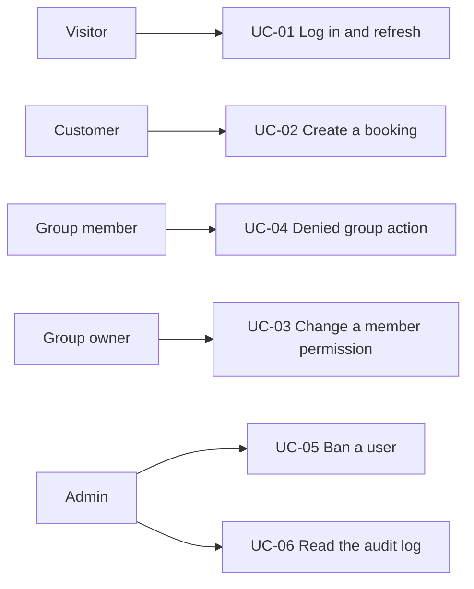
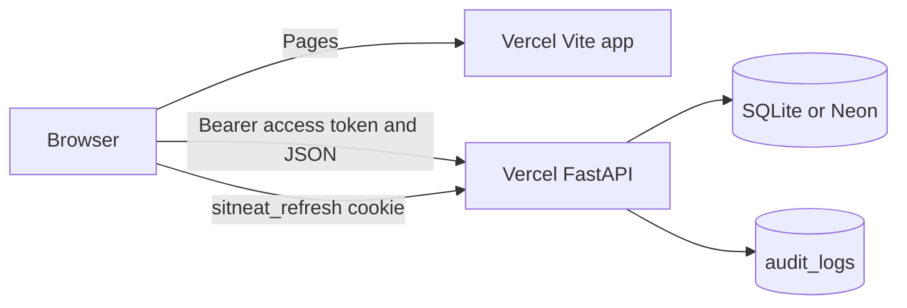
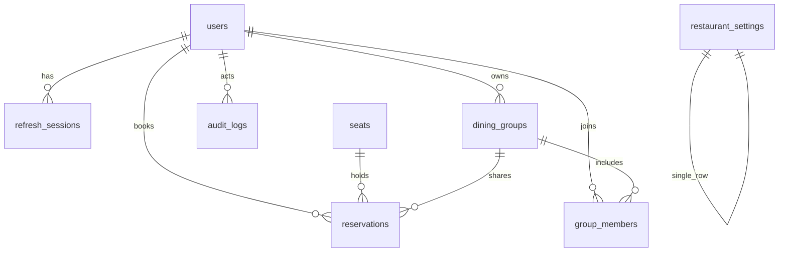
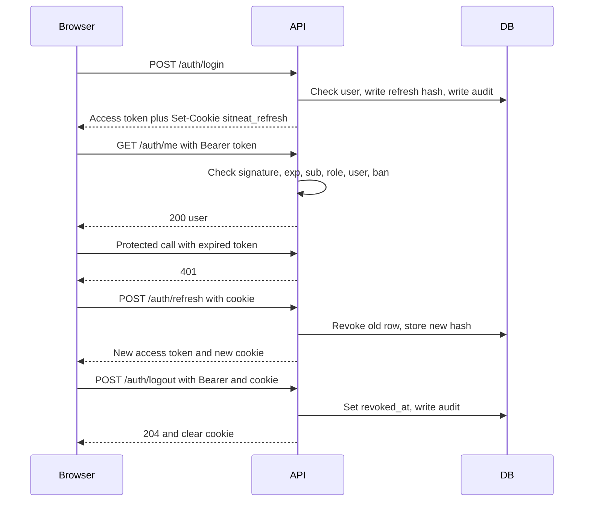
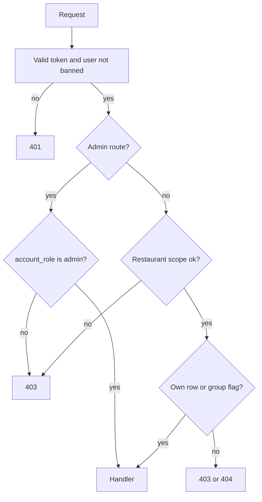
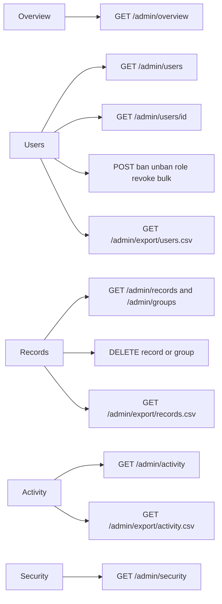
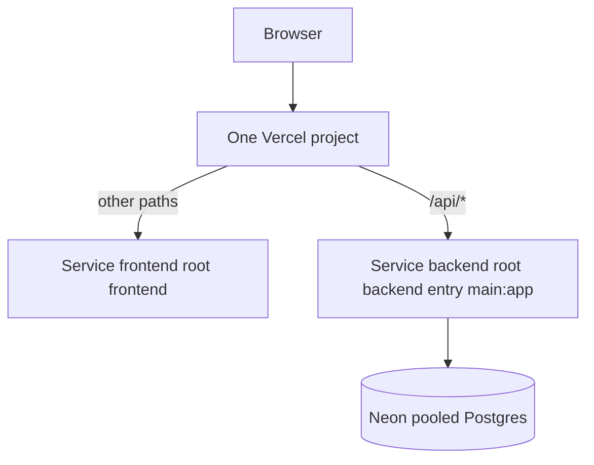

Independent University, Bangladesh
CSE309 Web Application & Internet

# Final Project Submission Report

**Submitted by:**
Name: MAKSUDUL KABIR VUBON
Student ID: 2220229
Section: 6
Team Number: Individual

Project Title: SitNeat — restaurant seat reservations
Vercel URL: https://2220229-s06-seatneat.vercel.app
GitHub Repository: https://github.com/2220229-art/2220229-S06-SeatNEat

**Submitted To:**
Sayef Reyadh
Adjunct Lecturer
Department of Computer Science & Engineering
Independent University, Bangladesh

Semester: Autumn 2026
Date of Submission: 23 November 2026

## How to use this report

This file describes the finished SitNeat application. Every requirement ID in Part B is the same ID used in the tests and in the screenshot list. Diagrams are numbered Figure 1 onward. Tables are numbered Table 1 onward. Screenshots are numbered S1 onward.

Passwords, secret keys, and full tokens are not written here. Test account emails and passwords go only in the PDF appendix. Screenshot images are pasted into the PDF. This markdown file keeps the caption and the requirement each picture must prove.

The public Vercel site is the mid-term deployment. The security, group, and admin work in this report runs in the local project. It was not deployed again for this submission, so S1–S17 and S21 are taken from the local app until a new deploy. S18–S20 can be taken from the existing Vercel project.

## Table of Contents

1. Executive Summary
2. Part A. Product Requirements (PRD)
3. Part B. Software Requirements (SRS)
4. Part C. Technical Design (TDD)
5. Part D. Evidence
6. Part E. Project Management and Conclusion

### List of figures and screenshots

| Number | Caption | Where |
| --- | --- | --- |
| Figure 1 | Use case diagram | Part B5 |
| Figure 2 | System architecture | Part C2 |
| Figure 3 | Entity-relationship diagram | Part C4 |
| Figure 4 | JWT login, request, refresh, and logout | Part C6 |
| Figure 5 | Authorisation flow for one request | Part C7 |
| Figure 6 | Admin pages and the endpoints they call | Part C8 |
| Figure 7 | Deployment layout | Part C10 |
| S1–S6 | User side | Part D1 |
| S7–S9 | Security behaviour | Part D2 |
| S10–S17 | Admin dashboard | Part D3 |
| S18–S20 | Deployment | Part D4 |
| S21 | Automated test output | Part D5 |

## 1. Executive Summary

### 1.1 Project overview

SitNeat is a seat reservation system for one restaurant. A guest creates an account, checks which tables are free, and books a seat with a food preference and an allergy note. Staff see the day’s bookings and move them from confirmed to seated or completed. A manager looks after seats, staff accounts, opening hours, and booking rules. An admin looks after accounts, groups, the activity log, and exports.

The stack is React 19 with TypeScript and Vite, FastAPI with SQLModel, SQLite locally or PostgreSQL on Neon, and Vercel for hosting.

### 1.2 What was built since the mid assessment

The mid assessment already had registration, login, seat booking, staff status updates, and the manager screens. Since then the project adds:

- JWT authentication with refresh and logout
- Role based access control (account roles `user` and `admin`, restaurant jobs, ownership, and group permissions)
- Admin dashboard (users, reservations and groups, activity log, security view, CSV exports)
- Audit logging, brute-force lockout, and the existing Vercel layout ready for a later deploy

### 1.3 Live links

Passwords and test account emails are not in this table. They belong in the PDF appendix.

**Table 1. Live links**

| Item | Link |
| --- | --- |
| GitHub repository | https://github.com/2220229-art/2220229-S06-SeatNEat |
| Planning issue | https://github.com/2220229-art/2220229-S06-SeatNEat/issues/1 |
| Documentation pull request | https://github.com/2220229-art/2220229-S06-SeatNEat/pull/2 |
| Vercel frontend | https://2220229-s06-seatneat.vercel.app |
| API on that site | https://2220229-s06-seatneat.vercel.app/api/v1/health |
| API docs on that site | https://2220229-s06-seatneat.vercel.app/api/docs |
| Video demo | Not recorded |

The health and docs URLs above belong to the mid-term deployment. They show the new admin and group routes only after the project is deployed again.

## Part A. Product Requirements (PRD)

### A1. Problem Statement

A small restaurant takes seat bookings by phone or on paper. The host then has to remember who is coming, which table is free, and whether a guest asked for vegetarian food or named an allergy. Two people can be promised the same table. A guest who wants to change a booking has to call again. Staff have no single list for the day.

That mess matters at the door. A double booking means turning a guest away. A missed allergy note means serving the wrong food. The restaurant needs one shared record of who is coming, without giving every guest a view of every other guest.

### A2. Users and Roles

SitNeat keeps two ideas separate. The **account role** is `user` or `admin`. It is the role inside the access token. The **restaurant job** is customer, staff, or manager. It decides the booking screens. A dining group is a shared party. The owner and the members do not have the same rights. An admin does not gain extra rights inside a group just by being an admin.

**Table 2. Users and roles**

| Role | Who they are | Main tasks | What they must never be able to do |
| --- | --- | --- | --- |
| Visitor | A person who is not signed in | Open the home page, register, log in | Read bookings, open admin, or call a protected route |
| User (customer) | A guest with account role `user` and job `customer` | Book a seat, see only their own bookings, edit a confirmed booking before the cutoff | See another guest’s booking, manage seats or staff, open admin |
| User (staff) | Floor staff with account role `user` and job `staff` | See today’s bookings and update status | Change opening hours, manage seats or staff, open admin |
| Group member | A signed-in person added to a dining group | Do only the actions the owner turned on: create, update, or assign | Rename the group, delete it, or change members |
| Group owner | The person who created the group | Rename, delete, manage members, and do every group booking action | Use those owner actions on a group they do not own |
| Admin | Account role `admin`. In the demo data both admins are also managers | Open the admin dashboard, ban a normal account, read the audit log, export CSV, and use the manager screens | Ban another admin, ban themselves, or change their own role. They also cannot run owner-only group actions unless they own that group |

### A3. Goals and Success Measures

**Table 3. Goals and measures**

| ID | Goal | Measure |
| --- | --- | --- |
| G1 | A guest can register and book only for themselves | `GET /reservations/mine` returns that guest’s rows. Another guest’s booking returns 404 |
| G2 | A wrong or missing login does not reveal which part failed | Unknown email and wrong password both return 401 with the same message |
| G3 | Sessions are short-lived and can be revoked | Access token lifetime is at most 15 minutes. Logout or session revoke sets `revoked_at` on the refresh row |
| G4 | Guessing a password is slowed down | Five failed logins lock the account for 15 minutes and the next attempt returns 429 |
| G5 | A member cannot do a group action they were not given | A member without `can_create` receives 403 on a group booking |
| G6 | An admin can inspect and moderate, but cannot attack another admin | Ban of another admin and a change of the caller’s own role both return 403 |

G3 and G4 are the security goals. G1 is the ownership goal.

### A4. Scope and Non-Goals

**In scope**

- Registration, login, short access tokens, refresh cookies, logout, profile, password change, and session revoke
- Account roles, restaurant job checks, ownership, and group permissions
- Dining groups and the admin dashboard
- Audit log and lockout after failed logins
- Seat booking for one restaurant, including food preference and allergy notes
- Deployment layout on Vercel, with Neon when `DATABASE_URL` is set

**Out of scope**

- Payments, because the restaurant still takes money at the table
- Email or SMS reminders, because there is no mail provider in this project
- More than one restaurant, because the brief is one dining room
- A native mobile app and a public marketing site

**Assumptions and constraints**

- Guests use a current desktop browser. The layout is a single column up to 1100 pixels. It was not built as a separate phone app.
- The clock for bookings is `Asia/Dhaka` unless the manager changes the setting.
- Hosting is one Vercel project with a Vite service and a FastAPI service. A hosted database is required if data must survive a restart on Vercel.
- The course calendar limited the work to one student and one term.

### A5. User Stories

**Table 4. User stories**

| ID | Story |
| --- | --- |
| US-01 | As a visitor, I want to register so that I can book a seat without calling the restaurant. |
| US-02 | As a visitor, I want to log in so that the app knows which bookings are mine. |
| US-03 | As a user, I want to change my name and password so that my account stays mine. |
| US-04 | As a user, I want to revoke a session so that a lost device cannot keep using my account. |
| US-05 | As a customer, I want to see only my bookings so that other guests stay private. |
| US-06 | As a group owner, I want to choose what each member can do so that a shared booking is not open to everyone. |
| US-07 | As a group member without create permission, I want the app to stop me so that I cannot book for the group by mistake. |
| US-08 | As a staff member, I want today’s list so that I can seat guests as they arrive. |
| US-09 | As an admin, I want to search users and ban a normal account with a reason so that a problem account cannot keep calling the API. |
| US-10 | As an admin, I want the activity log and a CSV export so that I can see what happened and keep a copy. |
| US-11 | As an admin, I want the server to refuse a ban of another admin so that one admin cannot lock the other out. |
| US-12 | As a customer, I want a free seat for my party size, food choice, and allergy note so that the kitchen knows what to prepare. |

## Part B. Software Requirements (SRS)

### B1. Introduction

This part states what the finished SitNeat API and React screens shall do. The readers are the examiner, a developer who must rebuild the system, and the student who will test it. The restaurant rules from the mid assessment still apply.

**Table 5. Definitions**

| Term | Meaning in SitNeat |
| --- | --- |
| JWT | A signed JSON Web Token used as the access token (RFC 7519) |
| Access token | HS256 JWT with `sub`, `role`, `iat`, and `exp`. Lifetime at most 15 minutes. Sent as `Authorization: Bearer` |
| Refresh token | A random string. Only its SHA-256 hash is stored. The browser receives it as the httpOnly cookie `sitneat_refresh` |
| RBAC | Checks that decide whether the caller may run an action. SitNeat checks the account role, the restaurant job, ownership, and group flags |
| Role | `users.account_role` is `user` or `admin`. `users.role` is the restaurant job: `customer`, `staff`, or `manager` |
| Permission | A group flag: `can_create`, `can_update`, or `can_assign`. The owner may do all three without the flags |
| Audit log | A row in `audit_logs` with the action, actor, target, IP address, browser, detail, and time |

References used while building this: RFC 7519 for JWT claim names, RFC 9106 for Argon2id password hashing, the OWASP Application Security Verification Standard for generic login errors and session revocation, and the FastAPI documentation for dependencies and `HTTPBearer`.

### B2. Functional Requirements

Each sentence is something the running system does. The error body is always `{ "code", "message" }` and, on validation errors, `details`. The prefix for these paths is `/api/v1`.

**Table 6. Authentication requirements**

| ID | Requirement |
| --- | --- |
| FR-AUTH-01 | The system shall create a public signup as an active customer with account role `user`, and shall ignore any role sent in the body. |
| FR-AUTH-02 | The system shall reject an unknown email and a wrong password with the same 401 message, `Invalid email or password.` |
| FR-AUTH-03 | The system shall store passwords as Argon2id hashes of the password plus a server pepper, and shall not store the pepper in the database. |
| FR-AUTH-04 | The system shall issue an access token of at most 15 minutes that includes the user id (`sub`) and the account role (`role`). |
| FR-AUTH-05 | The system shall store only the SHA-256 hash of the refresh token, send the raw token as an httpOnly cookie on path `/api`, and rotate that token on each refresh. |
| FR-AUTH-06 | The system shall revoke the current refresh row and clear the cookie on logout. |
| FR-AUTH-07 | The system shall revoke every refresh session for that user when a refresh token that was already revoked is presented again. |
| FR-AUTH-08 | The system shall let a person list their own sessions and revoke one session by id. |
| FR-AUTH-09 | The system shall lock an account for 15 minutes after five failed logins and shall return 429 while the lock holds. |
| FR-AUTH-10 | The system shall let a signed-in person update their own name. |
| FR-AUTH-11 | The system shall change a password only when the current password is correct, the new password is different, and the new password has at least 8 characters with one letter and one number. |

**Table 7. Access-control requirements**

| ID | Requirement |
| --- | --- |
| FR-RBAC-01 | The system shall treat `user` and `admin` as the only valid access-token roles and shall reject a token with any other role. |
| FR-RBAC-02 | The system shall enforce restaurant job scopes on the server for seats, reservations, staff, settings, and reports. |
| FR-RBAC-03 | The system shall return a customer’s own reservations from `GET /reservations/mine`, and shall return 404 when a customer asks for another customer’s reservation. |
| FR-RBAC-04 | The system shall allow only the group owner to rename the group, delete it, or add, change, and remove members. |
| FR-RBAC-05 | The system shall require `can_create`, `can_update`, or `can_assign` for the matching group booking action, and shall allow the owner to do all three. |
| FR-RBAC-06 | The system shall hide a group from a person who is not the owner or a member by returning 404. |
| FR-RBAC-07 | The system shall return 403 when a signed-in user who is not an admin calls an admin route. |
| FR-RBAC-08 | The system shall refuse, with 403, an admin ban of another admin, a ban of the caller’s own account, and a change of the caller’s own role. |
| FR-RBAC-09 | The system shall reject a banned or inactive account on the next request that needs an access token, including refresh. |

**Table 8. Admin requirements**

| ID | Requirement |
| --- | --- |
| FR-ADM-01 | The system shall give an admin overview counts for users, banned accounts, reservations, groups, and creations in the last seven days. |
| FR-ADM-02 | The system shall list users with search, account-role filter, status filter, and pagination (`offset`, `limit` from 1 to 100, default 20). |
| FR-ADM-03 | The system shall show one user’s detail, including reservation count, group count, sessions, and the latest activity. |
| FR-ADM-04 | The system shall ban a normal user with a reason, revoke that user’s sessions, and unban them later. |
| FR-ADM-05 | The system shall let an admin change another user’s account role between `user` and `admin`. Setting `admin` also sets the restaurant job to manager. Setting `user` on a manager sets the job to customer. |
| FR-ADM-06 | The system shall let an admin revoke all refresh sessions for a chosen user. |
| FR-ADM-07 | The system shall run bulk ban and bulk unban and return how many ids were changed and how many were skipped. Bulk ban shall skip missing users, the caller, and other admins. |
| FR-ADM-08 | The system shall list and delete reservations and groups from the admin records views. Deleting a group shall clear `group_id` on its reservations. |
| FR-ADM-09 | The system shall list the audit log with an action filter, a text search, and pagination. |
| FR-ADM-10 | The system shall show failed logins grouped by IP address and by account. |
| FR-ADM-11 | The system shall export users, reservations, and activity as CSV using the same filters as the list, and shall write an `export` audit row for each download. |

**Table 9. Restaurant requirements**

| ID | Requirement |
| --- | --- |
| FR-DOMAIN-01 | The system shall let a customer create a confirmed reservation for a seat, party size, start time, food preference, and allergy note. |
| FR-DOMAIN-02 | The system shall block a new booking that overlaps a confirmed or seated booking on the same seat. A booking that ends at a time shall not block one that starts at that same time. |
| FR-DOMAIN-03 | The system shall require allergy details when the declaration is `specified`, and shall reject a party larger than the seat capacity. |
| FR-DOMAIN-04 | The system shall allow the status flow confirmed → seated → completed, and shall allow cancel from confirmed. Seated, completed, and cancelled bookings shall not be reopened. |
| FR-DOMAIN-05 | The system shall let a customer change or cancel their own confirmed booking only before the cutoff. |
| FR-DOMAIN-06 | The system shall let staff read and update today’s operational list, and shall let a manager manage seats, staff accounts, opening hours, and the summary report. |
| FR-DOMAIN-07 | The system shall set the reservation end time from the restaurant duration. The customer shall not send the end time. |
| FR-DOMAIN-08 | The system shall interpret booking times in the configured timezone, which defaults to `Asia/Dhaka`. |

### B3. Non-Functional Requirements

**Table 10. Non-functional requirements**

| ID | Area | Requirement |
| --- | --- | --- |
| NFR-01 | Security | Secrets (`SECRET_KEY`, `PASSWORD_PEPPER`, `DATABASE_URL`) shall come from the environment. `.env.example` shall contain names and example placeholders only. Production startup shall refuse the example secret and the example pepper. |
| NFR-02 | Security | Login errors for an unknown email and a wrong password shall be identical. Unhandled errors shall return `SERVER_ERROR` and shall not return a stack trace. |
| NFR-03 | Performance | Admin list endpoints shall accept `limit` from 1 to 100 and shall default to 20. A formal latency budget was not measured. |
| NFR-04 | Usability | Protected pages shall stay on “Loading…” until `/auth/me` or `/auth/refresh` finishes. Failed requests shall show the API `message`. |
| NFR-05 | Reliability | With SQLite on disk, or with Neon when `DATABASE_URL` is set, rows shall still be there after the API process restarts. |
| NFR-06 | Maintainability | Account and group permission checks shall live in `backend/app/access.py`. Restaurant scopes shall live in `backend/app/security.py`. `pytest` shall cover the rules in Part C11. |
| NFR-07 | Security | CORS shall allow the configured frontend origin and local development origins, with credentials, and shall not use `*`. |

### B4. Roles and Permission Matrix

These tables match the code. “Own” means the row must belong to the caller. Group member and group owner are extra to the restaurant job. An admin has no extra rights inside a group.

**Table 11. Endpoint groups by role**

| Endpoint group | Visitor | Customer | Staff | Group member | Group owner | Admin |
| --- | --- | --- | --- | --- | --- | --- |
| `POST /auth/register`, `POST /auth/login` | Yes | Yes | Yes | Yes | Yes | Yes |
| Profile, password, own sessions | No | Yes | Yes | Yes | Yes | Yes |
| `POST /reservations`, `GET /reservations/mine` | No | Yes | No | Only with `can_create` for a group id | Yes for a group id | No, unless the account is also a customer |
| `GET /reservations/{id}` | No | Own, else 404 | Yes | Own, else 404 | Own, else 404 | Yes, because demo admins are managers |
| `GET /reservations/today`, status update | No | No | Yes | No | No | Yes (manager job) |
| Seats, staff, settings write, summary | No | Read seats and settings only | Read seats, settings, and today’s list | Same as their job | Same as their job | Yes |
| Admin routes under `/admin` | No | 403 | 403 | 403 | 403 | Yes |
| Rename, delete, or edit members | No | Only if owner | Only if owner | No | Yes | Only if that admin owns the group. Moderation delete is a separate admin route |

**Table 12. Group permissions**

| Action | `can_create` | `can_update` | `can_assign` | Owner only |
| --- | --- | --- | --- | --- |
| Create a reservation for the group | Yes | No | No | Owner may also do this |
| Change party size on a group reservation | No | Yes | No | Owner may also do this |
| Assign a different seat | No | No | Yes | Owner may also do this |
| Rename the group, delete it, add or remove a member, change flags | No | No | No | Yes |

In the demo group **Window party**, the customer is the owner, the staff member can update and assign, and the second guest can create.

**Table 13. Admin rules**

| Rule | Result |
| --- | --- |
| Admin changes their own role | 403 `You cannot change your own role.` |
| Admin bans another admin, or bans themselves | 403 |
| Bulk ban includes an admin or the caller | That id is counted in `skipped` |
| Admin opens a group they do not own and tries to rename it | 403. Account role `admin` does not bypass `require_owner` |
| Banned user calls a protected route | 401 `Please log in to continue.` |

### B5. Use Cases

Figure 1 shows the actors and the six use cases written out below.



**Figure 1.** Use case diagram. A visitor logs in. A customer books. An owner changes a member’s flags. A member can be denied. An admin bans and reads the log.

**Table 14. Use case descriptions**

| ID | Actor | Preconditions | Main flow | Errors | Postconditions |
| --- | --- | --- | --- | --- | --- |
| UC-01 | Visitor who already has an account | Account is active and not locked | 1. Submit email and password. 2. Server checks the hash. 3. Server returns an access token and sets `sitneat_refresh`. 4. Later the browser calls `POST /auth/refresh` and receives a new access token and a new cookie. | 401 if the password is wrong. 429 if the account is locked. 401 if the refresh cookie is missing, expired, or already revoked. Reuse of a revoked refresh token revokes every session. | A live refresh row exists. The old refresh row is revoked after rotation. |
| UC-02 | Customer | Signed in. A seat is free | 1. Open Book. 2. Choose date, time, and party size. 3. `GET /seats/availability` returns free seats. 4. Submit food preference and allergy note. 5. `POST /reservations` returns 201. | 409 if the seat overlaps. 422 if allergy details are missing. 403 if a staff account calls this route. | A confirmed reservation exists with `customer_id` equal to the caller. |
| UC-03 | Group owner | Signed in. The group exists | 1. Open Groups. 2. Choose a member. 3. `PATCH /groups/{id}/members/{member_id}` sets `can_create`, `can_update`, or `can_assign`. | 403 if the caller is not the owner. 404 if the group is hidden. | The member’s flags match the request. |
| UC-04 | Group member | Signed in. `can_create` is false | 1. Try to create a booking with that `group_id`. 2. `require_group_permission` checks the flag. | 403 `You do not have permission for this action.` | No reservation is created. |
| UC-05 | Admin | Signed in as admin. Target is a normal user | 1. Open Admin, Users. 2. Enter a reason. 3. `POST /admin/users/{id}/ban`. 4. Target’s next protected call fails. | 403 if the target is an admin. 404 if the id is missing. | `banned_at` is set, `is_active` is false, and that user’s refresh rows are revoked. An audit row `ban` is stored. |
| UC-06 | Admin | Signed in as admin | 1. Open Activity. 2. Filter by action or search text. 3. `GET /admin/activity` returns a page. | 403 if the caller is not an admin. | The rows on screen match the filter. Nothing in the log is deleted by reading it. |

### B6. Acceptance Criteria

**Table 15. Acceptance criteria**

| ID | Given | When | Then |
| --- | --- | --- | --- |
| FR-AUTH-04 | A valid login | The access token is decoded | `sub` is the user id, `role` is `user` or `admin`, and `exp` is at most 15 minutes ahead |
| FR-AUTH-04 | An access token past `exp` | A protected route is called | The response is 401 |
| FR-AUTH-07 | A refresh token that was already rotated | That old token is sent again | The response is 401 and every session for that user is revoked |
| FR-RBAC-01 | A token whose signature was edited, or whose `role` is not `user` or `admin` | Any protected route is called | The response is 401 |
| FR-RBAC-03 | Two customers | Customer A requests customer B’s reservation id | The response is 404 |
| FR-RBAC-05 | A member with `can_create` false | They book with that group id | The response is 403 |
| FR-RBAC-07 | A customer access token | `GET /admin/overview` is called | The response is 403 |
| FR-RBAC-08 | Two admin accounts | One bans the other, or changes their own role | The response is 403 |
| FR-RBAC-09 | A user who was just banned | They call `GET /auth/me` or refresh | The response is 401 |
| FR-AUTH-09 | An active account | The wrong password is sent five times | The account locks and the next login returns 429 |
| FR-AUTH-11 | A signed-in user | Password change is sent with the wrong current password | The response is 401 and the hash is unchanged |

### B7. Traceability Matrix

**Table 16. Requirement, endpoint or screen, test, screenshot**

| Requirement | Endpoint or screen | Test | Screenshot |
| --- | --- | --- | --- |
| FR-AUTH-01 | `POST /auth/register`, Register page | `test_t01_register_ignores_requested_role` | S1 |
| FR-AUTH-02 | `POST /auth/login` | `test_t02_bad_password_and_inactive_account_are_rejected` | S1 |
| FR-AUTH-03 | `backend/app/security.py` `hash_password` | Covered by every login test | — |
| FR-AUTH-04 | `POST /auth/login`, `create_access_token` | `test_login_token_contains_user_id_and_role` | S7 |
| FR-AUTH-05, FR-AUTH-06, FR-AUTH-07 | `POST /auth/refresh`, `POST /auth/logout` | Refresh rotation is implemented in `auth.py`. An automated reuse test is not in the suite | S8 |
| FR-AUTH-08 | `GET /auth/sessions`, `DELETE /auth/sessions/{id}`, Profile page | Not covered by a named test | S4 |
| FR-AUTH-09 | `POST /auth/login` | `test_wrong_password_locks_the_account` | S16 |
| FR-AUTH-10, FR-AUTH-11 | `PATCH /auth/profile`, `POST /auth/password`, Profile page | `test_password_change_requires_the_current_password` | S3 |
| FR-RBAC-01, FR-RBAC-07 | `decode_access_token`, `GET /admin/overview` | `test_missing_and_tampered_tokens_are_rejected`, `test_customer_cannot_open_admin_overview` | S6, S7 |
| FR-RBAC-02, FR-RBAC-03 | Reservation and seat routes | `test_t04_customer_cannot_read_another_customers_booking`, `test_t05_customer_cannot_manage_seats_or_staff` | S2, S6 |
| FR-RBAC-04 | `PATCH /groups/{id}` | `test_only_the_owner_can_rename_a_group` | S5, S6 |
| FR-RBAC-05 | `POST /groups/{id}/reservations` | `test_member_without_create_permission_cannot_book_for_the_group` | S6 |
| FR-RBAC-08 | `POST /admin/users/{id}/ban`, `POST /admin/users/{id}/role` | `test_admin_cannot_ban_another_admin`, `test_admin_cannot_change_own_role` | S13 |
| FR-RBAC-09 | `get_current_user` | `test_banned_user_is_rejected_on_the_next_request` | S9 |
| FR-ADM-01 | `GET /admin/overview`, Admin Overview | Not covered by a named test | S10 |
| FR-ADM-02, FR-ADM-03 | `GET /admin/users`, `GET /admin/users/{id}` | Not covered by a named test | S11, S12 |
| FR-ADM-04, FR-ADM-06 | Ban, unban, revoke sessions | Ban of a normal user is used inside `test_banned_user_is_rejected_on_the_next_request` | S12, S13 |
| FR-ADM-07, FR-ADM-08 | Bulk ban, records, groups | Not covered by a named test | S14 |
| FR-ADM-09, FR-ADM-11 | Activity and CSV export | Not covered by a named test | S15, S17 |
| FR-ADM-10 | `GET /admin/security` | Not covered by a named test | S16 |
| FR-DOMAIN-01 to FR-DOMAIN-08 | Booking, seats, staff, settings pages | `test_t06` through `test_t13`, `test_today_list_and_summary`, `test_cancelled_booking_releases_the_seat` | S2 |

Rows marked “not covered by a named test” are still implemented. Part E3 records that gap.

## Part C. Technical Design (TDD)

### C1. Technology Stack

Versions below are the minimums in `backend/requirements.txt` and the ranges in `frontend/package.json`. The machine that ran the tests used the versions installed in `backend/.venv`.

**Table 17. Technology stack**

| Component | Technology | Version | Why it was chosen |
| --- | --- | --- | --- |
| Frontend | React, TypeScript | React ^19.3.0, TypeScript ^7 | Course frontend. Typed components for pages and forms |
| Routing | React Router | ^7.18.4 | Page guards for customer, staff, and manager |
| Build | Vite | ^8.3.2 | Dev server on port 5173 and a proxy to the API |
| UI library | None | — | Plain CSS in `frontend/src/index.css`. No component library |
| Backend | FastAPI | >=0.141.1 | JSON API, dependencies, and OpenAPI docs |
| Database | SQLite or PostgreSQL (Neon) | SQLite file, or Neon when `DATABASE_URL` is set | SQLite needs no server locally. Neon keeps rows on Vercel |
| ORM | SQLModel | >=0.0.22 | Tables and queries in one model |
| Password hashing | pwdlib with Argon2 | pwdlib >=0.2.1 | Argon2id is a current password hash. A pepper is added before hashing |
| JWT | PyJWT | >=2.10.0 | HS256 access tokens |
| Testing | pytest, httpx | pytest >=8.3.0, httpx >=0.27.0 | API tests through FastAPI’s test client |
| Hosting | Vercel, two services | `vercel.json` | One project serves the Vite app and the FastAPI app |

### C2. System Architecture



**Figure 2.** System architecture. The browser loads pages from the frontend service, calls `/api/v1` on the API service, and sends the refresh cookie only to paths under `/api`.

The browser loads HTML and JavaScript from the Vite app. In production, Vercel sends `/api/*` to FastAPI and every other path to the frontend. During local development, Vite proxies `/api` to FastAPI on port 8000.

Each API call that needs a user sends `Authorization: Bearer` plus the access token. The refresh token is not in that header. The browser sends the cookie `sitneat_refresh` because `credentials: "include"` is set and the cookie path is `/api`.

FastAPI reads and writes `users`, `seats`, `reservations`, `refresh_sessions`, `dining_groups`, and `group_members` in the database. Login, logout, ban, role change, delete, and export also insert a row in `audit_logs`.

### C3. Backend and Frontend Structure

```text
backend/
  main.py
  requirements.txt
  app/
    access.py
    config.py
    database.py
    deps.py
    errors.py
    models.py
    request_meta.py
    schemas.py
    security.py
    seed.py
    services.py
    timeutil.py
    routers/
      admin.py
      auth.py
      groups.py
      reports.py
      reservations.py
      seats.py
      settings.py
      staff.py
  tests/
    conftest.py
    test_api.py
    test_config.py
    test_final_security.py
```

`main.py` builds the app, CORS, and the error handlers. `routers/` holds HTTP paths. `services.py` holds booking rules. `models.py` holds the tables. `security.py` holds password hashing, restaurant scopes, and JWT create/decode. `access.py` is the only module for admin and group checks. `deps.py` loads the current user from the bearer token. `seed.py` inserts demo rows when the database is empty and `SEED_DEMO` is on.

```text
frontend/
  package.json
  vite.config.ts
  src/
    App.tsx
    api.ts
    auth.tsx
    format.ts
    main.tsx
    types.ts
    index.css
    components/
      Layout.tsx
      ReservationDetail.tsx
      ReservationTable.tsx
      StatusActions.tsx
    pages/
      AdminPage.tsx
      BookPage.tsx
      GroupsPage.tsx
      LandingPage.tsx
      LoginPage.tsx
      ManagerPage.tsx
      ProfilePage.tsx
      RegisterPage.tsx
      ReservationsPage.tsx
      StaffPage.tsx
```

`api.ts` is the only fetch wrapper. It adds the bearer token, sends cookies, and retries a 401 once through `/auth/refresh`. `auth.tsx` keeps the user and the access token, restores a session on load, and `RequireAuth` sends the wrong restaurant job to `/unauthorized`. The Admin link in `Layout.tsx` is rendered only when `account_role` is `admin`.

### C4. Data Model



**Figure 3.** Entity-relationship diagram. `restaurant_settings` is a single settings row, not a link to users.

**Table 18. `users`**

| Column | Type | Keys and rules |
| --- | --- | --- |
| id | integer | Primary key |
| full_name | string | Required |
| email | string | Unique, indexed |
| password_hash | string | Argon2id hash. Never sent to the client |
| role | string | `customer`, `staff`, or `manager`. Check constraint |
| account_role | string | `user` or `admin`. Indexed. This is the JWT role |
| is_active | boolean | False after a ban |
| failed_attempts | integer | Reset to 0 on a successful login |
| locked_until | datetime or null | Set for 15 minutes after five failures |
| banned_at, ban_reason | datetime or null, string or null | Set by an admin ban |
| created_at, updated_at | datetime | UTC |

**Table 19. `seats`**

| Column | Type | Keys and rules |
| --- | --- | --- |
| id | integer | Primary key |
| seat_number | string | Unique, indexed |
| capacity | integer | 1 to 20 |
| description | string or null | |
| is_active | boolean | Inactive seats cannot be booked |
| created_at, updated_at | datetime | UTC |

**Table 20. `reservations`**

| Column | Type | Keys and rules |
| --- | --- | --- |
| id | integer | Primary key |
| customer_id | integer | Foreign key `users.id`, indexed |
| seat_id | integer | Foreign key `seats.id`, indexed |
| start_at, end_at | datetime | `end_at` must be after `start_at`. `start_at` is indexed |
| party_size | integer | 1 to 20 |
| food_preference | string | `vegetarian` or `non_vegetarian` |
| allergy_declaration | string | `none` or `specified` |
| allergy_details | string or null | Required by the service when declaration is `specified` |
| status | string | `confirmed`, `seated`, `completed`, or `cancelled` |
| group_id | integer or null | Foreign key `dining_groups.id`, indexed |
| created_at, updated_at | datetime | UTC |

**Table 21. `restaurant_settings`**

| Column | Type | Keys and rules |
| --- | --- | --- |
| id | integer | Primary key |
| open_time, close_time | string | Clock times |
| duration_minutes, slot_interval_minutes | integer | Slot interval must be 15, 30, or 60 |
| min_lead_minutes, advance_days, change_cutoff_minutes | integer | Used by the booking rules |
| timezone | string | Default `Asia/Dhaka` |
| updated_at | datetime | UTC |

**Table 22. `refresh_sessions`**

| Column | Type | Keys and rules |
| --- | --- | --- |
| id | integer | Primary key |
| user_id | integer | Foreign key `users.id`, indexed |
| token_hash | string | Unique SHA-256 of the refresh token. The raw token is not stored |
| expires_at | datetime | `REFRESH_TOKEN_DAYS` after creation, default 14 |
| revoked_at | datetime or null | Set on rotation, logout, revoke, or ban |
| replaced_by_id | integer or null | Id of the session that replaced this one |
| ip_address, user_agent | string or null | Taken from the request |
| created_at | datetime | UTC |

**Table 23. `dining_groups` and `group_members`**

| Table | Column | Type | Keys and rules |
| --- | --- | --- | --- |
| dining_groups | id | integer | Primary key |
| dining_groups | name | string | Required |
| dining_groups | owner_id | integer | Foreign key `users.id`, indexed |
| dining_groups | created_at | datetime | UTC |
| group_members | id | integer | Primary key |
| group_members | group_id | integer | Foreign key `dining_groups.id`, indexed |
| group_members | user_id | integer | Foreign key `users.id`, indexed |
| group_members | can_create, can_update, can_assign | boolean | Default false. Unique pair `(group_id, user_id)` |
| group_members | created_at | datetime | UTC |

**Table 24. `audit_logs`**

| Column | Type | Keys and rules |
| --- | --- | --- |
| id | integer | Primary key |
| actor_id | integer or null | Foreign key `users.id`. Null when the email is unknown |
| action | string | `login`, `login_failed`, `logout`, `password_change`, `role_change`, `ban`, `unban`, `delete`, `export` |
| target_type | string | For example `user`, `session`, `reservation`, `group` |
| target_id | integer or null | |
| ip_address, user_agent, detail | string or null | |
| created_at | datetime | UTC, written by the server |

Roles live in `users.account_role` and `users.role`. Bans live in `banned_at`, `ban_reason`, and `is_active`. Sessions live in `refresh_sessions`, never as a raw token. Group membership and the three flags live in `group_members`. The activity log is `audit_logs`.

There is no separate index beyond the primary keys, the unique email, the unique seat number, the unique token hash, and the unique group-member pair. List filters in the admin routes run in Python after a full read.

### C5. API Design

Every path below is under `/api/v1` except the extra health alias `/api/health`. A success with no body uses 204. Validation uses 422 `VALIDATION_ERROR`. A missing row uses 404 `NOT_FOUND`. A permission failure uses 403 `FORBIDDEN`. A bad or missing token uses 401 `UNAUTHORIZED`. A lock uses 429 `LOCKED`.

**Table 25. Auth and health**

| Method and path | Auth | Body | Success | Errors |
| --- | --- | --- | --- | --- |
| GET `/api/health`, GET `/api/v1/health` | No | — | 200 `{status: ok}` | |
| POST `/auth/register` | No | name, email, password | 201 user | 409 email taken, 422 |
| POST `/auth/login` | No | email, password | 200 access token, user. Sets cookie | 401, 429 |
| POST `/auth/refresh` | Cookie | — | 200 new access token. Rotates cookie | 401 |
| POST `/auth/logout` | Bearer | — | 204. Clears cookie | 401 |
| GET `/auth/me` | Bearer | — | 200 user | 401 |
| PATCH `/auth/profile` | Bearer | full_name | 200 user | 401, 422 |
| POST `/auth/password` | Bearer | current_password, new_password | 204 | 401, 422 |
| GET `/auth/sessions` | Bearer | — | 200 list | 401 |
| DELETE `/auth/sessions/{id}` | Bearer, own row | — | 204 | 401, 404 |

**Table 26. Groups**

| Method and path | Auth | Body | Success | Errors |
| --- | --- | --- | --- | --- |
| GET `/groups` | Bearer | — | 200 groups the caller owns or has joined | 401 |
| POST `/groups` | Bearer | name | 201 | 401, 422 |
| GET `/groups/{id}` | Member or owner | — | 200 | 401, 404 |
| PATCH `/groups/{id}` | Owner | name | 200 | 401, 403, 404 |
| DELETE `/groups/{id}` | Owner | — | 204 | 401, 403, 404 |
| POST `/groups/{id}/members` | Owner | email, three flags | 200 | 401, 403, 404 |
| PATCH `/groups/{id}/members/{member_id}` | Owner | flags | 200 | 401, 403, 404 |
| DELETE `/groups/{id}/members/{member_id}` | Owner | — | 204 | 401, 403, 404 |
| POST `/groups/{id}/reservations` | Owner or `can_create` | reservation body | 201 | 401, 403, 409, 422 |
| PATCH `/groups/{id}/reservations/{id}` | Owner or `can_update` | party size | 200 | 401, 403 |
| PATCH `/groups/{id}/reservations/{id}/seat` | Owner or `can_assign` | seat id | 200 | 401, 403, 404 |

**Table 27. Admin.** Every row requires a valid access token whose user passes `require_admin`. Anyone else receives 401 or 403.

| Method and path | Extra rule | Success |
| --- | --- | --- |
| GET `/admin/overview` | — | 200 counts |
| GET `/admin/users` | Query `q`, `account_role`, `status`, `offset`, `limit` | 200 page |
| GET `/admin/users/{id}` | — | 200 detail, or 404 |
| POST `/admin/users/{id}/ban` | Body `reason`. Not self, not an admin | 200, or 403 |
| POST `/admin/users/{id}/unban` | — | 200 |
| POST `/admin/users/{id}/role` | Body `account_role`. Not self | 200, or 403 |
| POST `/admin/users/{id}/sessions/revoke` | — | 204 |
| POST `/admin/users/bulk-ban` | Body `ids`, `reason` | 200 `{changed, skipped}` |
| POST `/admin/users/bulk-unban` | Body `ids` | 200 `{changed, skipped}` |
| GET `/admin/records` | Query `status`, `q`, `offset`, `limit` | 200 page |
| DELETE `/admin/records/{id}` | — | 204 |
| POST `/admin/records/bulk-delete` | Body `ids` | 200 `{changed}` |
| GET `/admin/groups` | Query `q`, `offset`, `limit` | 200 page |
| DELETE `/admin/groups/{id}` | — | 204 |
| GET `/admin/activity` | Query `action`, `q`, `offset`, `limit` | 200 page |
| GET `/admin/security` | — | 200 failed-login totals |
| GET `/admin/export/users.csv` | Same user filters | 200 CSV, writes audit |
| GET `/admin/export/records.csv` | Optional `status` | 200 CSV, writes audit |
| GET `/admin/export/activity.csv` | Same activity filters | 200 CSV, writes audit |

**Table 28. Restaurant routes**

| Method and path | Who | Success | Errors |
| --- | --- | --- | --- |
| GET `/seats`, GET `/seats/{id}`, GET `/seats/availability` | Any job with `seats:read` | 200 | 401, 403 |
| POST, PATCH, DELETE `/seats` | Manager | 201, 200, 204 | 401, 403, 409 if the seat is in use |
| POST `/reservations` | Customer | 201 | 401, 403, 409, 422 |
| GET `/reservations/mine` | Customer | 200 own rows | 401, 403 |
| GET `/reservations/today` | Staff or manager | 200 | 401, 403 |
| GET `/reservations` | Manager | 200, optional date and status filters | 401, 403 |
| GET `/reservations/{id}` | Customer own, or staff, or manager | 200 | 404 for another customer |
| PATCH `/reservations/{id}` | Customer, own, confirmed, before cutoff | 200 | 404, 409 |
| DELETE `/reservations/{id}` | Customer own, or manager | 204 | 403, 404 |
| POST `/reservations/{id}/cancel` | Customer own, or staff | 200 | 403, 409 |
| PATCH `/reservations/{id}/status` | Staff or manager | 200 | 403, 409 |
| GET, POST, PATCH, DELETE `/staff` | Manager | 200, 201, 204 | 401, 403 |
| GET `/settings` | Any signed-in job | 200 | 401 |
| PUT `/settings` | Manager | 200 | 403, 422 |
| GET `/reports/summary` | Manager | 200 | 403 |

OpenAPI is served at `/api/docs`, `/api/redoc`, and `/api/openapi.json`. Those documentation paths are not under `/api/v1`.

### C6. JWT Authentication Design



**Figure 4.** JWT sequence for login, a protected request, expiry, refresh, and logout. If the refresh cookie was already revoked, the API revokes every session for that user and returns 401.

**Table 29. Access-token claims**

| Claim | Value |
| --- | --- |
| sub | User id as a string |
| role | `user` or `admin` |
| iat | Issued-at unix time |
| exp | At most 15 minutes after `iat` |
| alg | HS256. The secret is `SECRET_KEY` from the environment |

`create_access_token` caps the lifetime at 15 minutes even if `ACCESS_TOKEN_EXPIRE_MINUTES` is higher. The refresh token lasts `REFRESH_TOKEN_DAYS` (default 14). The access token is short so a stolen bearer token stops working quickly. The refresh token is longer so a guest is not sent to the login form on every page load, and it can be revoked because the server stores it.

The access token is kept in `sessionStorage`. Any script on the page can read it. That is an XSS risk. The refresh token is an httpOnly cookie, so page script cannot read it. The cookie is `SameSite=Lax`, `Path=/api`, and `Secure` when `APP_ENV` is `production`. A cross-site POST does not receive a Lax cookie in current browsers, which is the CSRF control. There is no separate CSRF token.

On every protected request, `get_current_user` checks that a bearer token exists, that the signature and expiry are valid, that `sub` and `role` are present, that `role` is `user` or `admin`, that the user row exists, and that the user is active and not banned. Restaurant routes then check scopes.

On a 401, `api.ts` calls `/auth/refresh` once. If that returns a new access token, the original request is sent again with the new token. If refresh fails, the client clears `sessionStorage` and the screen returns to login.

### C7. RBAC Design

A request is authorised in this order:

1. `get_current_user` checks the token, loads the user, and rejects a banned or inactive account.
2. Restaurant routes add a scope such as `reservations:read:own`. The scope must be in the set for `users.role`.
3. Admin routes call `require_admin`, which checks `account_role`.
4. Ownership is applied in the query or immediately after the load. `list_own` filters `customer_id == user.id`. `get_visible_reservation` returns 404 when a customer asks for someone else’s id.
5. Group routes call `require_owner` or `require_group_permission`.
6. The handler runs only after those checks.

The account roles are `user` and `admin`. The restaurant jobs are `customer`, `staff`, and `manager`. The group actions are the strings `create`, `update`, and `assign`.

The reusable check is `require_group_permission` in `backend/app/access.py`:

```python
def require_group_permission(session: Session, user: User, group_id: int, action: str) -> DiningGroup:
    group = _group_or_404(session, group_id)
    if group.owner_id == user.id:
        return group
    member = membership(session, group.id or 0, user.id or 0)
    if member is None:
        raise AppError(403, "FORBIDDEN", "You are not a member of this group.")
    allowed = {
        "create": member.can_create,
        "update": member.can_update,
        "assign": member.can_assign,
    }.get(action, False)
    if not allowed:
        raise AppError(403, "FORBIDDEN", "You do not have permission for this action.")
    return group
```



**Figure 5.** Authorisation flow. Token and ban are checked first. Admin routes then check `account_role`. Other routes check the restaurant scope and then ownership or a group flag.

A new restaurant job would be added to the `Role` enum, the scope sets in `security.py`, and the React `RequireAuth` list. A new group flag would be a boolean column on `group_members` and a new key in the `allowed` map above. A new account role would be added to `AccountRole` and to the allow-list in `decode_access_token`.

Admins do not skip group ownership. Banned users fail inside `get_current_user` before any handler runs. Ban also revokes that user’s refresh sessions, so a later refresh fails as well.

### C8. Admin Dashboard Design

The Admin page has five tabs: Overview, Users, Records, Activity, and Security. The React route `/admin` allows the restaurant job `manager`. The nav link is shown only for `account_role === "admin"`. The API still checks `require_admin`, so a manager who is not an admin receives 403.



**Figure 6.** Admin pages and the endpoints they call.

**Table 30. Admin page, filters, actions, and audit events**

| Page | Endpoints | Filters | Actions | Audit events |
| --- | --- | --- | --- | --- |
| Overview | GET `/admin/overview` | None | Read only | None |
| Users | GET `/admin/users`, GET `/admin/users/{id}` | Search text, role, status. API also accepts offset and limit | Ban with reason, unban, role change, revoke sessions, bulk ban, bulk unban, CSV | `ban`, `unban`, `role_change`, `export` |
| Records | GET `/admin/records`, GET `/admin/groups` | API accepts status, search, offset, and limit. The screen loads the first page | Delete one reservation, delete one group, CSV of reservations | `delete`, `export` |
| Activity | GET `/admin/activity` | Action and search text | CSV | `export` |
| Security | GET `/admin/security` | None | Read failed logins by IP and by account | None |

Bulk ban and bulk unban return `changed` and `skipped`. The screen calls those endpoints with the selected ids. CSV export uses the same query filters as the list (`q`, `account_role`, and `status` for users; `status` for records; `action` and `q` for activity) and writes one `export` row. The React lists do not yet draw page buttons. The API still pages at 20 rows unless `offset` and `limit` are sent. That gap is in Part E3.

### C9. Security Design and Threats

**Table 31. Threats, defences, and where they live**

| Threat | Defence | File or module |
| --- | --- | --- |
| Password database leak | Argon2id of password plus pepper. Pepper is not a column | `backend/app/security.py`, `PASSWORD_PEPPER` |
| Stolen access token | Expires within 15 minutes. Banned users fail on the next call | `create_access_token`, `get_current_user` |
| Stolen refresh token | Hash stored only. Rotation on refresh. Reuse revokes all sessions. Cookie is httpOnly | `backend/app/routers/auth.py` |
| Brute-force login | Same error for unknown email and bad password. Lock for 15 minutes after five failures | `login` in `auth.py` |
| Privilege escalation | Admin routes call `require_admin`. Own-role change and admin-to-admin ban return 403. Signup ignores a submitted role | `access.py`, `admin.py`, `auth.py` |
| Another user’s reservation | `list_own` filters by `customer_id`. A customer receives 404 for someone else’s id | `backend/app/services.py` |
| Cross-site scripting | React text is escaped by React. Refresh cookie is httpOnly. Access token in `sessionStorage` is still readable by script | `frontend/src/auth.tsx` |
| Cross-site request forgery | Refresh cookie is `SameSite=Lax` and path `/api`. State-changing booking calls use the bearer token, which a foreign site does not have | `auth.py` cookie settings |
| CORS misuse | Allow-list is the frontend origin, localhost, and the Vercel host. Credentials are on. `*` is not used | `backend/app/config.py` `allowed_origins` |
| Secrets in the repository | `.env.example` has placeholders. Production refuses the example secret and pepper | `backend/main.py`, `.env.example` |
| SQL injection | Queries use SQLModel `select()` and bound parameters. Admin search does not build SQL from the query string | `routers/`, `services.py` |
| Over-posting | Register forces `customer` and `user`. Profile accepts only `full_name`. Password hash is not on `UserPublic` | `auth.py`, `schemas.py` |

### C10. Deployment on Vercel



**Figure 7.** Deployment layout. `vercel.json` sends `/api/*` to FastAPI and every other path to the Vite app. SPA routes such as `/login` fall back to `index.html`.

The frontend finds the API through `VITE_API_BASE`. That variable is left unset, so the site calls `/api/v1` on the same host. The hosted database is Neon when `DATABASE_URL` is the pooled connection string. Without that variable, a hosted function falls back to a SQLite file under `/tmp`, which does not keep data across a cold start.

**Table 32. Environment variable names**

| Name | What it is for |
| --- | --- |
| `APP_ENV` | `production` on Vercel. `development` locally |
| `SECRET_KEY` | HS256 signing secret. Required in production |
| `PASSWORD_PEPPER` | Extra string mixed into the password before Argon2. Required in production. Not stored in the database |
| `DATABASE_URL` | Neon pooled URL in production. Local default is `sqlite:///./sitneat.db` |
| `ACCESS_TOKEN_EXPIRE_MINUTES` | Requested access lifetime. The code still caps it at 15 |
| `REFRESH_TOKEN_DAYS` | Refresh lifetime. Default 14 |
| `FRONTEND_ORIGIN` | Extra CORS origin. Local default `http://localhost:5173` |
| `SEED_DEMO` | `true` creates demo accounts when the database is empty |
| `VITE_API_BASE` | Optional API prefix. Leave unset on Vercel |

To redeploy, push `main` and let the existing Vercel project build, or run the Vercel deploy from this repository with the root set to the repository folder. Set the names in Table 32 for Production and Preview before that deploy. Do not put the values in git.

This report does not claim a new production deploy. The URL in Table 1 is the earlier site. A later deploy is required before that URL shows Groups, Profile sessions, and Admin.

### C11. Testing

Automated tests call the API with FastAPI’s test client and a fresh SQLite file per test. They do not click the React screens. Manual checks on the live site apply to the mid-term build only, because the final screens are not deployed.

From `backend`, with the virtual environment active:

```powershell
pytest
```

On 23 November 2026 that command finished with **39 passed** in about 28 seconds. One Starlette warning was printed about `httpx`. No test failed.

**Table 33. Tests and results**

| Test | Requirement | Result |
| --- | --- | --- |
| `test_login_token_contains_user_id_and_role` | FR-AUTH-04 | Passed |
| `test_missing_and_tampered_tokens_are_rejected` | FR-RBAC-01 | Passed |
| `test_customer_cannot_open_admin_overview` | FR-RBAC-07 | Passed |
| `test_only_the_owner_can_rename_a_group` | FR-RBAC-04 | Passed |
| `test_member_without_create_permission_cannot_book_for_the_group` | FR-RBAC-05 | Passed |
| `test_admin_cannot_ban_another_admin` | FR-RBAC-08 | Passed |
| `test_admin_cannot_change_own_role` | FR-RBAC-08 | Passed |
| `test_banned_user_is_rejected_on_the_next_request` | FR-RBAC-09 | Passed |
| `test_wrong_password_locks_the_account` | FR-AUTH-09 | Passed |
| `test_password_change_requires_the_current_password` | FR-AUTH-11 | Passed |
| `test_t04_customer_cannot_read_another_customers_booking` | FR-RBAC-03 | Passed |
| `test_t01` through `test_t14` and the other cases in `test_api.py` | FR-DOMAIN and login rejection | Passed (22 tests in that file, including the two named above) |
| `test_config.py` | NFR-01, CORS host, Vercel database path | Passed (7 tests) |

There is no automated test that waits for a real 15-minute expiry. Expiry is rejected by PyJWT when `exp` is in the past, and the tamper test covers a bad signature. There is no automated test that reuses an old refresh token. The rotation and reuse logic is in `refresh` in `auth.py`.

## Part D. Evidence: Screenshots of the Running Application

Paste each picture into the PDF. Crop to the relevant area. Keep the address bar and the signed-in user visible where the shot is of the app. Mask passwords and tokens. For S1–S17 and S21, use http://localhost:5173 until the final build is deployed. After that deploy, retake them on the Vercel URL.

### D1. User Side

**S1.** Signup and login, with a validation error (password shorter than 8 characters, or the confirmation not matching). Proves FR-AUTH-01 and FR-AUTH-02.

**S2.** A logged-in customer’s booking list, showing only that customer’s reservations. Proves FR-RBAC-03 and FR-DOMAIN-01.

**S3.** Profile page and the change-password form, with the wrong current password rejected. Proves FR-AUTH-10 and FR-AUTH-11.

**S4.** The sessions list and the revoke action. Proves FR-AUTH-08.

**S5.** The Window party group page with members and their create, update, and assign flags. Proves FR-RBAC-04 and FR-RBAC-05.

**S6.** An action denied by RBAC, with the message in the app and the 403 response in the browser network tab. Proves FR-RBAC-05 or FR-RBAC-07.

### D2. Security Behaviour

**S7.** Network tab showing the `Authorization` header with the token masked, and an expired or tampered token returning 401. Proves FR-AUTH-04 and FR-RBAC-01.

**S8.** The refresh request returning a new access token, and the httpOnly cookie `sitneat_refresh` in the application tab. Proves FR-AUTH-05.

**S9.** A banned user rejected on the next request. Proves FR-RBAC-09.

### D3. Admin Dashboard

**S10.** Overview statistics. Proves FR-ADM-01.

**S11.** Users list with search and filters. The API pages the list. The screen does not yet show page buttons, so this shot should show search and filters, and the PDF caption should say that. Proves FR-ADM-02.

**S12.** User detail with sessions and recent activity. Proves FR-ADM-03.

**S13.** The ban dialog with a reason, and the banned state afterwards. Proves FR-ADM-04. A second shot of the 403 when banning the other admin proves FR-RBAC-08.

**S14.** Records and groups moderation, including a delete. Proves FR-ADM-08. Bulk ban, if shown, proves FR-ADM-07.

**S15.** Activity log with a filter, including the ban or export from the steps above. Proves FR-ADM-09.

**S16.** Security view with failed logins by IP and by account. Proves FR-ADM-10 and supports FR-AUTH-09.

**S17.** A CSV export downloaded and opened, with tokens and secrets absent. Proves FR-ADM-11.

### D4. Deployment

**S18.** The Vercel project with the production deployment and the domain `2220229-s06-seatneat.vercel.app`. This is the mid-term deployment.

**S19.** The Vercel environment variable names, with values hidden. Include `DATABASE_URL`, `SECRET_KEY`, `PASSWORD_PEPPER`, `APP_ENV`, and `SEED_DEMO` when they are set. Do not show the values.

**S20.** The live API documentation page. It shows the new routes only after the project is deployed again.

### D5. Tests

**S21.** The pytest output showing 39 passed. Proves the tests in Table 33. Taken from the local `backend` folder, not from the browser.

## Part E. Project Management and Conclusion

### E1. How to Run and Test

Prerequisites: Python 3.10 or newer, and Node.js 22.

Copy `.env.example` to `.env` at the repository root if you want to override the defaults. The app runs without that file. Example names and values:

```text
APP_ENV=development
SECRET_KEY=dev-only-sitneat-change-this-secret
DATABASE_URL=sqlite:///./sitneat.db
ACCESS_TOKEN_EXPIRE_MINUTES=15
PASSWORD_PEPPER=replace-with-a-long-random-string
REFRESH_TOKEN_DAYS=14
FRONTEND_ORIGIN=http://localhost:5173
SEED_DEMO=true
```

Do not use the example `SECRET_KEY` or the default pepper when `APP_ENV=production`.

Backend:

```powershell
cd backend
python -m venv .venv
.venv\Scripts\Activate.ps1
pip install -r requirements.txt
fastapi dev main.py
```

Frontend, in a second terminal:

```powershell
cd frontend
npm install
npm run dev
```

Open http://localhost:5173. API docs: http://localhost:8000/api/docs.

Tests, from `backend` with the virtual environment active:

```powershell
pytest
```

Log in with the demo accounts after the API has started on an empty database. The roles are two admins who are also managers, one staff user, and two customer users. One customer owns the group Window party. The staff user can update and assign in that group. The second customer can create in that group. The emails and passwords are in the PDF appendix only.

If an old `backend/sitneat.db` is missing the new columns, stop the server and delete that file so the demo rows are created again. Do not commit that database file.

### E2. GitHub Work

The public repository is https://github.com/2220229-art/2220229-S06-SeatNEat. The commits on `origin/main` are the initial project and the documentation pull request. The application code for booking, JWT, RBAC, groups, and the admin dashboard is in the local working tree and was not pushed as separate pull requests.

**Table 34. Issues and pull requests**

| Link | Title | What it delivered |
| --- | --- | --- |
| https://github.com/2220229-art/2220229-S06-SeatNEat/issues/1 | Implement full CRUD for reservations, seats, and staff | The planning issue for the restaurant records |
| https://github.com/2220229-art/2220229-S06-SeatNEat/pull/2 | Documentation pull request merged as `ae9f899` | PRD, SRS, and TDD documents on `main` |
| Local working tree, not a pull request | JWT, RBAC, admin dashboard, groups, audit log | The final behaviour described in this report. Not on `origin/main` at the time of writing |

The work is individual. The mid-term documents were merged through pull request 2. The final API and screens were written after that merge and are still uncommitted.

### E3. Limitations

- The admin, group, and session screens are not on the public Vercel URL until a new deploy. The live site can still be the mid-term build.
- Screenshot images are not embedded in this file. They belong in the PDF.
- Demo passwords are not in this file or in the README.
- The access token is stored in `sessionStorage`. A script that runs on the page can read it until it expires. The refresh token is the httpOnly cookie.
- There is no automated test for refresh reuse, for a real 15-minute expiry wait, or for the admin list and CSV screens.
- The admin React lists do not show page controls. The API defaults to 20 rows.
- Group seat assignment checks that the seat exists. It does not re-run the full overlap rules that a new booking uses.
- Admin search loads rows and filters them in Python. That is fine for a demo database and slow for a large one.
- A Vercel deploy without `DATABASE_URL` uses SQLite under `/tmp`. Those rows disappear when the function disk is cleared.
- Response time was not measured against a published budget.
- The layout has no separate phone stylesheet.
- There is no video demo.

### E4. Future Work

1. Deploy this build to the existing Vercel project with `PASSWORD_PEPPER`, `SECRET_KEY`, and the Neon `DATABASE_URL` set, so the public URL matches this report.
2. Add tests for refresh reuse, admin ban of a normal user through the HTTP route, and CSV export.
3. Add page controls on the admin lists. The API already accepts `offset` and `limit`.
4. Keep the access token in memory and restore it from the refresh cookie after every page load, so a script cannot read it from `sessionStorage`.
5. Apply the same overlap check when a member assigns a different seat.
6. Record a short video of the user path and the admin path for the appendix.

### E5. Sources, Libraries and Tools

**Table 35. Sources, libraries, and tools**

| Name | Version or link | What it was used for |
| --- | --- | --- |
| FastAPI and Starlette | requirements: fastapi[standard] >=0.141.1 | API, docs, middleware |
| Pydantic | Brought in by FastAPI | Request bodies |
| SQLModel | >=0.0.22 | Tables and queries |
| PyJWT | >=2.10.0 | HS256 access tokens |
| pwdlib and Argon2 | pwdlib[argon2] >=0.2.1 | Password hashes |
| psycopg | >=3.2.0 | Neon Postgres driver |
| React, React Router, TypeScript, Vite | package.json ranges in Table 17 | Interface |
| pytest and httpx | >=8.3.0 and >=0.27.0 | API tests |
| Neon | https://neon.tech | Hosted Postgres for a later deploy |
| Vercel | https://vercel.com | Earlier deployment and the two-service layout |
| RFC 7519 | https://www.rfc-editor.org/rfc/rfc7519 | JWT claim names |
| RFC 9106 | https://www.rfc-editor.org/rfc/rfc9106 | Argon2id |
| OWASP ASVS | https://owasp.org/www-project-application-security-verification-standard/ | Generic login errors and session revocation as a guide, not a full audit |
| FastAPI documentation | https://fastapi.tiangolo.com | Dependencies and security schemes |
| Course sample report | https://github.com/sayef-reyadh-labs/smarter-todo/blob/main/docs/FINAL_REPORT.md | Heading guide only. The SitNeat text and code are for this restaurant project |
| Cursor (Grok) | Used while writing this report | Helped organise the report to the course headings and check statements against the code and a local pytest run. The restaurant behaviour and the requirement text were checked in the SitNeat source |
